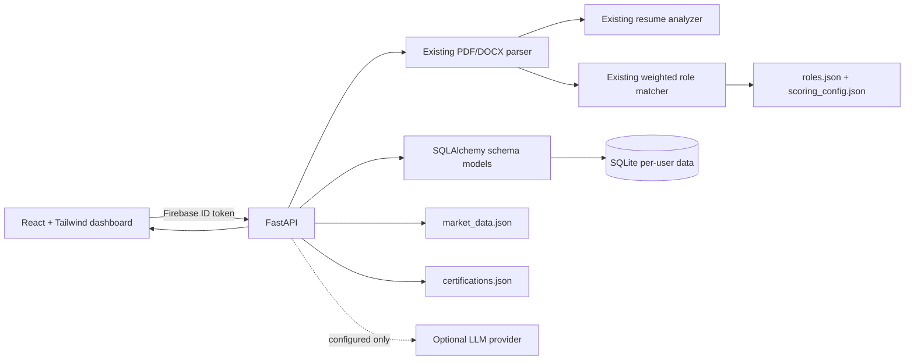
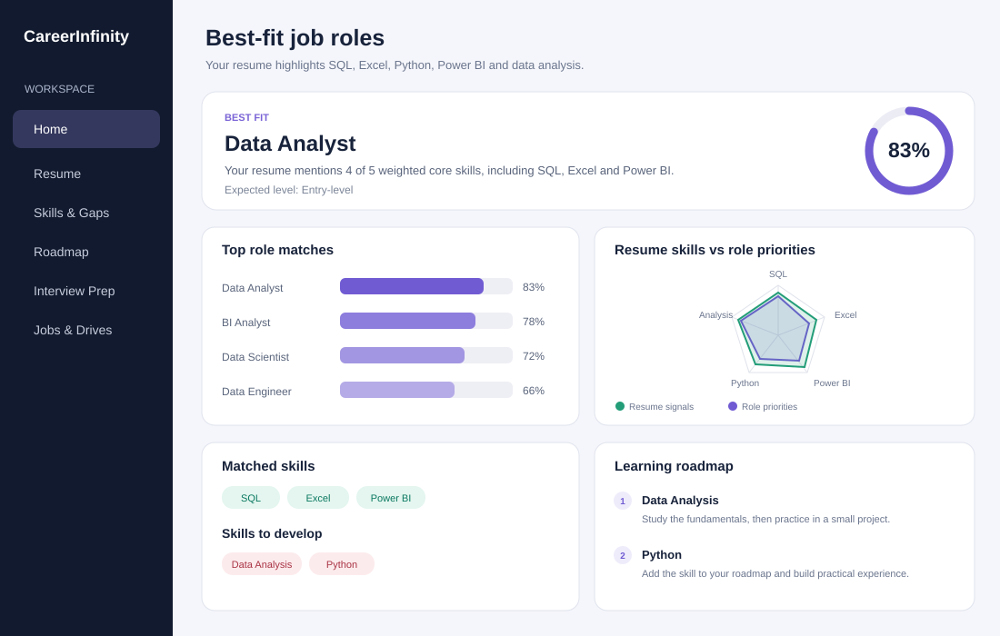
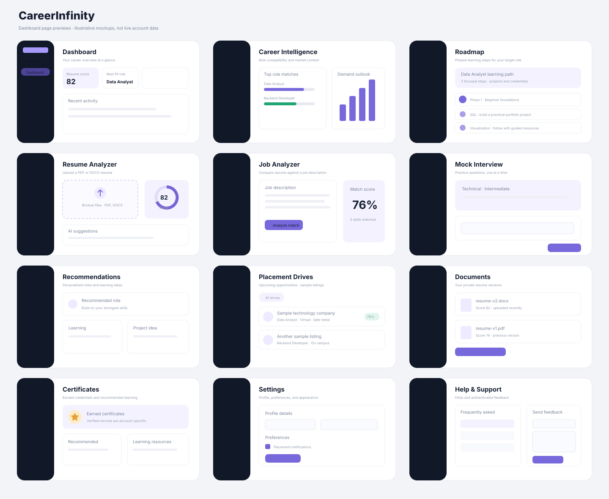

# CareerInfinity

CareerInfinity is an AI-powered career workspace with a React dashboard and a
FastAPI backend. Existing PDF/DOCX parsing and weighted best-fit role matching
are reused by the new dashboard.

## Run locally (Windows PowerShell)

```powershell
cd CareerInfinity
python -m venv .venv
.\.venv\Scripts\Activate.ps1
python -m pip install -r requirements.txt
npm ci
npm run build
python seed_data.py
python app.py
```

Open `http://127.0.0.1:5000/` to sign in and
`http://127.0.0.1:5000/dashboard` for the application. The dashboard opens on
Resume Analyzer by default. Firebase Authentication remains the existing auth
provider; each API call uses its verified Firebase ID token. The frontend does
not introduce a second JWT login system or bypass existing authentication.

For frontend development, run the API in one terminal and the Vite server in a
second:

```powershell
# Terminal 1
python app.py

# Terminal 2
npm run dev
```

Use the Vite server's `dashboard-app.html` entry during development. Set
`VITE_API_BASE_URL=http://127.0.0.1:5000` in a local frontend `.env` if the
development browser needs to call the API on a different origin; configure
CORS to allow that Vite origin. Development uses hash-based client routing so
Vite's API proxy can route API paths without intercepting page navigation.
Production uses normal `/dashboard/...` URLs and serves its static assets from
FastAPI.

The Firebase web settings in the existing sign-in page are public client
configuration, not server credentials. Restrict its API key and authorized
domains in Firebase/Google Cloud. `FIREBASE_PROJECT_ID` must match that
Firebase app. The API loads settings from a local `.env` file as well as the
process environment. Copy `.env.example` to `.env`, then set `OPENAI_API_KEY`
or `LLM_API_KEY`, `LLM_API_URL`, and `LLM_MODEL` to enable AI interview
questions and answer feedback. Keep the key on the server and out of source
control. Without a key, the interview page explains the required setup and
question generation returns a clear configuration error; it does not silently
substitute demo questions.

## Dashboard modules

The responsive React Router sidebar includes:

1. Dashboard overview, score, best-fit role, roadmap priorities, drives, and recent activity.
2. Career Intelligence with computed role compatibility and editable market data.
3. Roadmap with an editable 34-role catalog, role-specific stages, certification/course links, proof uploads, and per-resource progress.
4. Resume Analyzer with upload, existing resume score/suggestions, and role matching.
5. Job Analyzer comparing a job description with the latest saved resume.
6. Mock Interview with persisted sessions, optional LLM questions/feedback, and a report.
7. Recommendations for roles, courses, credentials, and projects.
8. Placement Drives with filters, match estimate, applications, and admin CRUD.
9. Documents for resume versions, downloads, deletion, and score comparison.
10. Certificates earned by the account and editable credential recommendations.
11. Profile, target role, location, notification, and theme settings.
12. Help/FAQ and persisted feedback.

The frontend is in `src/` and uses React, Tailwind CSS, Recharts, Lucide icons,
and React Router. The former `/skills` dashboard URL redirects to Roadmap; the
backend `/skills/gap` endpoint remains available for the legacy skill-gap data.
The Roadmap page uses `roadmaps.json`, and `python check_roadmap_links.py`
checks its resource URLs. Roadmap status and proof are stored per Firebase
user; `migrations/001_user_progress.sql` adds the SQLite progress table.
`npm run build` writes the production dashboard to `dist/`;
FastAPI serves the original sign-in page at `/` and the React app at
`/dashboard`.

## API overview

Existing APIs are retained:

- `POST /api/analyze-resume` — existing resume analysis response.
- `POST /match-roles` — existing role matching; accepts PDF/DOCX and `top_n`.
- `GET/PATCH /api/profile` — existing Firebase-authenticated profile.

The new dashboard endpoints use the same Firebase ID-token verification:

| Endpoint | Purpose |
|---|---|
| `GET /dashboard/summary` | Profile, latest analysis, best-fit role, recent activity |
| `POST /resume/analyze` | Reuses parser/scorer/matcher and saves a private resume version |
| `GET /career/intelligence?role=` | Resume role matches and market catalog |
| `GET /skills/gap?role=` | Role-specific learning steps and prioritized roadmap data |
| `GET /roadmaps` | Grouped role catalog from editable `roadmaps.json` |
| `GET /roadmaps/{role}/progress?weekly_study_hours=` | Stage/resource progress, hours, and estimated finish date |
| `PATCH /progress/{resource_id}` | Update a user's resource status, notes, or credential URL |
| `POST /progress/{resource_id}/proof` | Upload a PDF, PNG, or JPEG completion proof (5 MB maximum) |
| `GET /progress/{resource_id}/proof` | Download the signed-in user's proof file |
| `POST /jobs/analyze` | Compare a job description against the latest resume |
| `POST /interview/start` | Start and persist a mock-interview session |
| `POST /interview/{id}/answer` | Save an answer and return feedback |
| `GET /interview/{id}/report` | Session report and improvement tips |
| `GET /recommendations` | Roles, learning resources, and project ideas |
| `GET /drives?type=&sort=` | Filter and sort placement drives |
| `POST/PATCH/DELETE /drives[/{id}]` | Administrator-only drive CRUD |
| `POST /drives/{id}/apply` | Save interest in a drive for the signed-in user |
| `GET/POST /documents` | List or save resume versions |
| `GET/DELETE /documents/{id}` | Download or delete a resume version |
| `GET /documents/compare?first=&second=` | Compare two resume scores |
| `GET /certificates` | Earned credentials and recommended catalog |
| `GET/PATCH /settings` | User-specific profile and preferences |
| `POST /feedback` | Save authenticated user feedback |

Roadmap progress percentages count completed learning resources. Hours are
summed from the catalog's estimates; the finish date uses the requested weekly
study-hour budget. A resource is shown as proof-backed when it is marked
completed and has a proof URL or uploaded file. Proof is user supplied and is
not independently validated with issuers. Basic roadmap roles intentionally
have one foundation stage and are labeled as preliminary in the UI.

Set `DRIVE_ADMIN_TOKEN` to enable placement-drive writes. Send it as
`X-Admin-Token`; never put the token in browser-delivered frontend code. The
admin form in the dashboard only accepts the token at submission time.

SQLAlchemy models in `models.py` define the user, resume, analysis, interview,
drive, application, document, certificate, settings, and feedback tables. The
API keeps its established synchronous SQLite access patterns and per-user
ownership checks. Uploaded files are stored in the private SQLite database.
Set `CAREERINFINITY_DB_PATH` to an absolute path on persistent storage in a
hosted environment and protect/back up that database.

## Editable market and learning data

- `roles.json` defines the job-role catalog and required/nice-to-have skills.
- `scoring_config.json` controls best-fit scoring weights and result caching.
- `market_data.json` contains editable salary ranges, opportunity counts,
  growth classifications, and annual demand-index samples.
- `certifications.json` contains suggested learning/certification resources.
- `seed_drives.json` contains sample placement-drive entries.

Market figures and seeded placement listings are illustrative placeholders,
not sourced labor statistics or actual openings. The UI labels them as sample
data and returns the market `source` and `last_updated` note. Replace them with
verified figures and a real source before presenting them as factual.

## Role matching and scoring

At startup the existing scorer precomputes catalog-description embeddings
using `sentence-transformers/all-MiniLM-L6-v2`. Resume text is embedded per
request and cosine similarity is combined with weighted skills and experience.
Default component weights are 30% semantic similarity, 55% skill overlap, and
15% experience fit. The scorer caches results by resume hash and catalog
version. If the embedding package/model is unavailable, the server logs the
fallback and uses lexical cosine similarity instead.

If `OPENAI_API_KEY` or `LLM_API_KEY` is configured, an OpenAI-compatible
provider may review up to three role explanations, generate interview prompts,
and score mock-interview answers. Resume text and interview responses are sent
to that provider only when configured. Never use untrusted resume text as
instructions; the role-matching prompt treats it as data.

## Architecture



## Screenshots

The illustrations below are sample dashboard mockups, not user data. The live
screens show authenticated account data.




## Seed data

```powershell
python seed_data.py
```

This inserts clearly marked, future-dated sample drives and is safe to rerun.
Market data and certification recommendations are loaded from their JSON
catalogs. It deliberately does not create a demo login: authentication remains
bound to the configured Firebase project.

## Tests and evaluation

```powershell
npm test
python -m unittest discover -s . -p "*test.py" -v
python evaluate_role_matching.py
python evaluate_role_matching.py --skip-semantic
```

The role-ranking evaluation uses 20 synthetic labeled resumes. The measured
scores are a smoke test of these examples, not evidence of real-world hiring
accuracy. Tests cover resume parsing, role scoring, persistence, auth guards,
documents, drive administration, settings, and interview flows.

## Docker

```powershell
docker compose up --build
```

The multi-stage image builds the React app and runs FastAPI on port 5000.
SQLite is persisted in the `career_data` volume. Set
`FIREBASE_PROJECT_ID`, `DRIVE_ADMIN_TOKEN`, and optional LLM environment
variables through a protected deployment environment.

## Limitations

Resume and role scores are estimates, not hiring decisions. Keyword skill
signals do not verify proficiency; experience is estimated from explicit
years-of-experience text; scanned PDFs need OCR. Sample market and drive data
must be replaced with sourced, current information. Certificate rows are
account-scoped and remain empty until a trusted assessment/certificate issuer
records a verified credential. An LLM provider is optional and its generated
content can be inaccurate; review it before relying on it.
